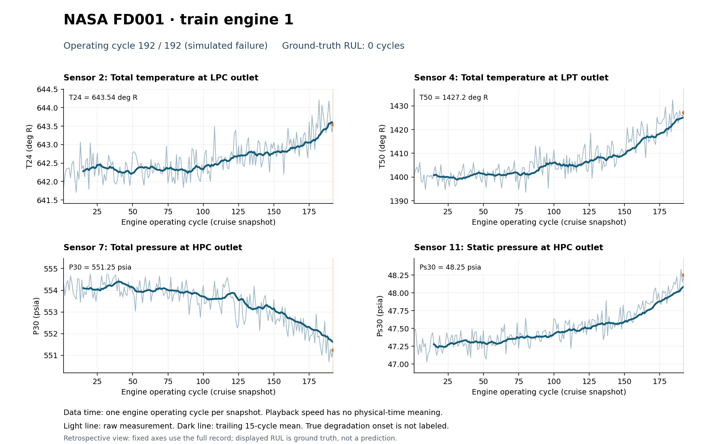

# NASA turbofan sensor explorer

Explore NASA C-MAPSS FD001 engine degradation measurements in Excel and as an animated video. This repository contains 100 complete training trajectories and 100 partial test trajectories, each with 21 sensor measurements and three operational settings.

## Files

```text
.
├── README.md
├── requirements.txt
├── get_nasa_turbofan.py
├── data/
│   ├── README.md
│   └── NASA_FD001_sensor_by_cycle.xlsx
└── video/
    ├── README.md
    ├── plot_turbofan_video.py
    ├── csv/FD001/
    │   ├── train.csv
    │   ├── test.csv
    │   └── test_engine_labels.csv
    └── output/
        ├── FD001_train_engine_001.mp4
        └── FD001_train_engine_001.png
```

## Explore the data

Open [the Excel workbook](data/NASA_FD001_sensor_by_cycle.xlsx). Its README tab explains the measurements and units. The Engine index identifies the row ranges for each engine. The Train sensors and Test sensors tabs place sensor descriptions down the rows and operating cycles across the columns.

See [data documentation](data/README.md) for the workbook layout and [video documentation](video/README.md) for CSV generation and plotting instructions.

## Make a video

The required CSV input files are included in the repository, allowing generation of a video to visualize the turbofan sensor data without downloading any additional datasets. From the repository root:

```bash
python3 -m pip install -r requirements.txt
python3 video/plot_turbofan_video.py --engine 1 --sensors 2 4 7 11
```

The script writes an MP4 and a final-frame PNG to `video/output/`. Choose a different engine or sensors with the command-line options described in [video/README.md](video/README.md).

[](video/output/FD001_train_engine_001.mp4)

[Watch or download the example video](video/output/FD001_train_engine_001.mp4).

## Regenerate the CSV inputs

```bash
python3 get_nasa_turbofan.py --subset FD001
```

The downloader uses the Python standard library. It downloads NASA's original archive to `CMAPSSData.zip` and writes raw text files and generated CSVs into `video/csv/FD001/`. The archive and extracted raw text files are excluded by `.gitignore`. The three generated CSVs are included in this repository. This command regenerates the CSVs; it does not rebuild the Excel workbook.

## Time axis and labels

- A time step is an engine operating cycle, represented by a cruise-condition snapshot. Calendar timestamps and elapsed seconds are not supplied.
- Engine IDs are local to the training or test split. Training engine 1 and test engine 1 are different engines.
- Training records reach simulated failure. Test records end before failure, with remaining useful life (RUL) supplied separately by NASA.
- The CSV `rul` column is evaluation ground truth. It is not a sensor measurement or a prediction, and should not be used as an input feature.
- The animation reveals raw readings and a trailing mean. Playback speed controls presentation speed only. Exact degradation-onset labels are not provided.

## Sources and citation

Data source: [NASA C-MAPSS Jet Engine Simulated Data](https://data.nasa.gov/dataset/cmapss-jet-engine-simulated-data).

Dataset citation: A. Saxena and K. Goebel (2008), *Turbofan Engine Degradation Simulation Data Set*, NASA Ames Prognostics Data Repository, NASA Ames Research Center, Moffett Field, CA.

Measurement definitions follow Table 2, page 3 of A. Saxena, K. Goebel, D. Simon and N. Eklund (2008), *Damage Propagation Modeling for Aircraft Engine Run-to-Failure Simulation*, PHM08. This document is included in NASA's original archive.

Related paper: Y. Cao, Y. Xie and N. Gebraeel, [*Multi-sensor slope change detection*](https://doi.org/10.1007/s10479-016-2185-5), Annals of Operations Research 263:163–189 (2018), section 6.3. The paper gives 100 training and 100 test engines without identifying a subset. Both FD001 and FD003 match those counts. This repository uses FD001; the authors' exact subset is unconfirmed. This repository visualizes the data and does not implement the paper's detection procedure.
