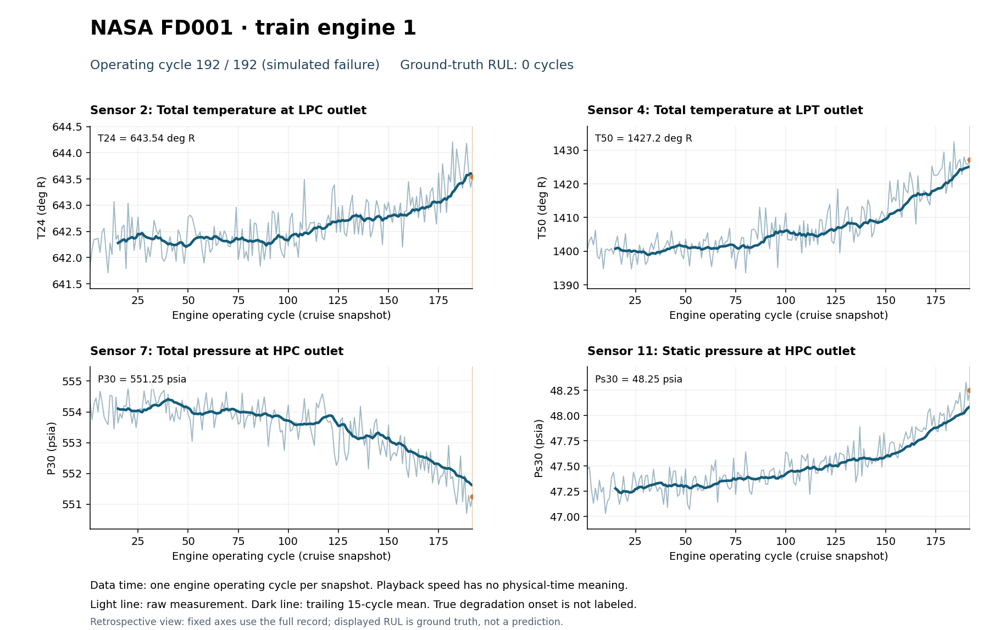

# Sensor video and CSV inputs

This folder contains the plotting script, its CSV inputs, and an example video for training engine 1. All 200 FD001 engines are available in the CSVs, so you can select other engines without another download.

## Included CSV files

The inputs are stored in `csv/FD001/`:

| File | Rows excluding header | Meaning |
| --- | ---: | --- |
| `train.csv` | 20,631 | Complete observations for 100 training engines |
| `test.csv` | 13,096 | Partial observations for 100 test engines |
| `test_engine_labels.csv` | 100 | Endpoint RUL and failure-cycle labels for each test engine |

In `train.csv` and `test.csv`, one row is one engine-cycle observation. The 27 columns are:

| Columns | Meaning |
| --- | --- |
| `engine_id` | Engine identifier within this split |
| `cycle` | Operating-cycle number for that engine |
| `setting_1`–`setting_3` | Three operational settings as supplied |
| `sensor_1`–`sensor_21` | Original sensor measurements |
| `rul` | Derived ground-truth remaining useful life, in cycles |

The engine-label file contains `engine_id`, `last_observed_cycle`, `rul_at_last_cycle` and `failure_cycle`.

## How the CSV files were generated

From the repository root, run:

```bash
python3 get_nasa_turbofan.py --subset FD001
```

The script downloads [NASA's original archive](https://data.nasa.gov/docs/legacy/CMAPSSData.zip) and reads three files:

- `train_FD001.txt`: full training trajectories, with 26 whitespace-separated columns per observation.
- `test_FD001.txt`: partial test trajectories with the same columns.
- `RUL_FD001.txt`: remaining cycles after each test engine's last observed cycle. The first value belongs to test engine 1, the second to test engine 2, and so on.

The 26 original columns become engine ID, cycle, three settings and 21 sensors. The script retains the numeric measurements and appends a `rul` column:

```text
Training RUL at cycle t = engine's final observed training cycle − t

Test failure cycle = final observed test cycle + NASA's supplied endpoint RUL
Test RUL at cycle t = test failure cycle − t
```

It also creates `test_engine_labels.csv`, with one row per test engine. No smoothing, normalization, interpolation, measurement-unit conversion or RUL capping is applied to the CSVs. They are generated directly from the raw NASA files, not extracted from Excel. The Excel workbook and video use the same CSV observations.

The downloader writes the CSVs and extracted raw text files into this folder's `csv/FD001/` directory. Only the CSVs are included in the repository; `.gitignore` excludes the raw text files and download archive. A valid local `CMAPSSData.zip` is reused if present at the repository root.

## Make a video

Run from the repository root:

```bash
python3 -m pip install -r requirements.txt
python3 video/plot_turbofan_video.py --engine 1 --sensors 2 4 7 11
```

The script reads the included CSVs and writes an MP4 plus a final-frame PNG to `video/output/`. Paths to CSVs and default outputs are resolved relative to the plotting script, so they also work when the script is launched from another working directory. An explicit `--output` path is relative to the working directory unless absolute.

Examples from the repository root:

```bash
# A different training engine
python3 video/plot_turbofan_video.py --engine 5 --sensors 2 4 7 11

# A test engine with a partial observation record
python3 video/plot_turbofan_video.py --split test --engine 1

# Compare a constant channel with changing channels
python3 video/plot_turbofan_video.py --sensors 1 2 7 11

# Change smoothing and playback speed
python3 video/plot_turbofan_video.py --window 15 --fps 10 --step 1

# GIF instead of MP4
python3 video/plot_turbofan_video.py --output video/output/engine1.gif
```

Use one to six sensor numbers from 1–21. Each panel identifies the physical measurement, symbol and unit. The default sensors are:

| Sensor | Symbol | Measurement | Unit |
| --- | --- | --- | --- |
| 2 | T24 | Total temperature at low-pressure-compressor outlet | Degrees Rankine |
| 4 | T50 | Total temperature at low-pressure-turbine outlet | Degrees Rankine |
| 7 | P30 | Total pressure at high-pressure-compressor outlet | psia |
| 11 | Ps30 | Static pressure at high-pressure-compressor outlet | psia |

## Read the animation

The horizontal axis is engine operating cycle, with one cruise-condition snapshot per cycle. It does not encode a calendar date or elapsed seconds. Playback FPS changes presentation speed only.

The light line shows raw readings. The dark line shows a trailing mean using the current and preceding `window − 1` cycles. It appears only after a complete window and does not use future measurements. The orange dot and vertical marker identify the current observation. The final frame is held for two seconds.

The example shows gradual upward temperature/static-pressure drift and downward total-pressure drift amid noise. It is a retrospective view: axis limits are based on the full selected record. The RUL counter displays evaluation ground truth, not a prediction. No exact degradation-onset labels or fitted change-point results are presented.

[Watch the example MP4](output/FD001_train_engine_001.mp4).



Source and citations: [repository README](../README.md#sources-and-citation). Complete measurement descriptions and units: [Excel workbook](../data/NASA_FD001_sensor_by_cycle.xlsx), README and data tabs.
